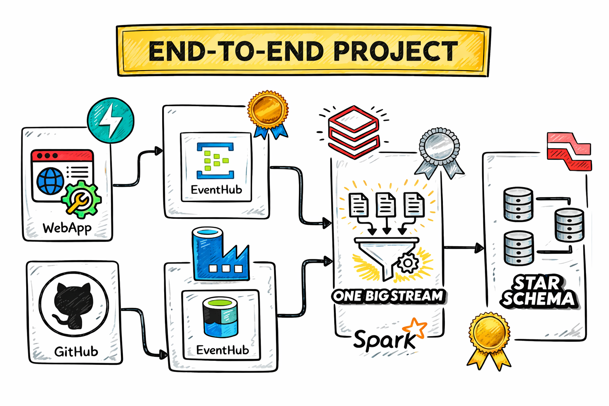

# Uber Real-Time Data Engineering Project

An end-to-end learning project focused on ingesting ride-related data, processing events, and transforming data for downstream analytics.

**Project status:** In progress — developing the Silver transformation layer.

## Project Overview

This project explores a real-time data engineering pipeline, from ingestion through event processing and data transformation. The goal is to learn how streaming data can be ingested, processed, validated, and organized for analytics.

## Architecture

## Technology Stack

- **Python** — ingestion and pipeline logic
- **APIs** — data ingestion and integration
- **Azure** — cloud environment used during development
- **Streaming data processing** — event ingestion and processing
- **Data transformation** — cleansing, standardization, and Silver-layer development
- **Git and GitHub** — version control and documentation

Specific services and implementation details will be documented as the pipeline develops.

## Current Progress

- Set up the local development environment.
- Implemented and tested API-related Python scripts.
- Configured connectivity to the cloud environment.
- Started working on the Silver transformation layer.

## Planned Work

- Complete Silver-layer transformations and validation.
- Develop a Gold layer for analytics-ready datasets.
- Test the end-to-end pipeline.
- Document data quality checks and execution steps.

## Repository Structure

- `api.py` — API-related logic
- `connection.py` — connection and integration logic
- `data.py` — data processing logic
- `Code_Files/` — supporting project code and notebooks
- `Data/` — project data files
- `templates/` — project templates
- `architecture.png` — architecture diagram
- `requirements.txt` — Python dependencies

## Getting Started

1. Clone this repository.
2. Create and activate a Python virtual environment.
3. Install dependencies from `requirements.txt`.
4. Configure required environment variables and credentials locally.
5. Follow the project scripts and configuration to run the workflow.

Never commit API keys, access tokens, passwords, or `.env` files.

## Learning Reference

This project uses the following tutorial as a learning reference. The repository will document my progress, experiments, and improvements.

- **Original tutorial:** [Uber Data Engineer Project — Ansh Lamba](https://youtu.be/5KIbhHo6GJA)
- **Original repository:** [Ansh Lamba's Uber Data Engineer Project](https://github.com/anshlambagit/Uber_Data_Engineer_Project)
